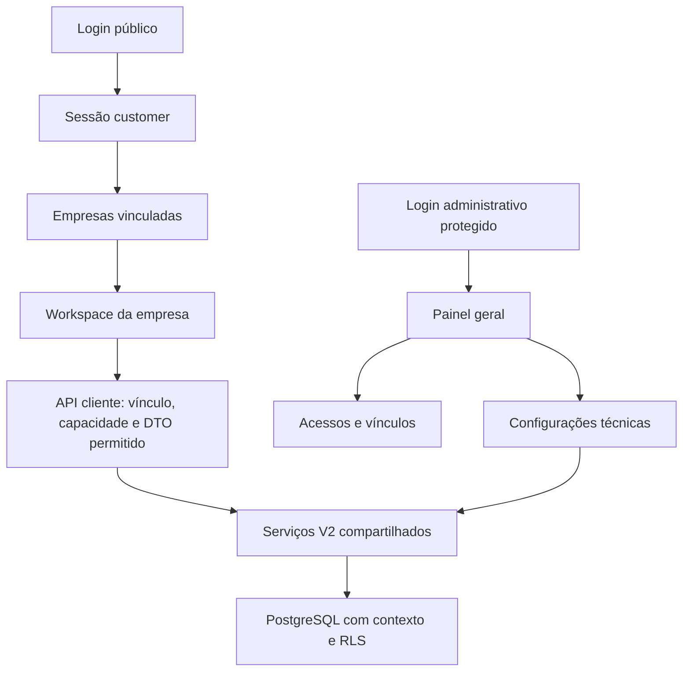

# WAIA 2.0.0 — planejamento do acesso multiusuário por empresa

Atualizado em **23/10/2026**. Estado: **M0 concluída localmente**, M1–M10 planejadas. Branch: **`new`**, criada de `dev`, HEAD `3b8a295` / v1.23.1, preservando alterações locais. Candidata M0: **v1.23.3**, sem commit/push. **2.0.0 é a entrega futura**. Evidências e ambiente: [M0_AMBIENTE.md](docs/M0_AMBIENTE.md).

Este roteiro substitui o escopo SaaS de setembro/2026. F0–F9 permanecem como história no Git e no [RELATORIO.md](RELATORIO.md), sem equivalência automática com as novas etapas M0–M10. [PLAN.md](PLAN.md) contém somente índice e gates; este documento concentra os requisitos. Operação: [OPERACAO_RELEASE.md](docs/OPERACAO_RELEASE.md).

## 1. Produto e limites autorizados

Entregar aplicação web com login inicial. Depois de autenticar, o usuário vê as empresas vinculadas ao seu acesso, escolhe uma delas e configura o atendimento. O titular WAIA mantém administração geral, cadastro de empresas, criação de acessos e gestão dos vínculos.

Requisitos obrigatórios:

1. Login individual por e-mail/senha; não compartilhar senha por empresa.
2. Relação N:N: um login pode acessar várias empresas e uma empresa pode ter vários logins, com capacidades independentes por vínculo.
3. **Somente o administrador geral cadastra empresas, cria/habilita acessos e define vínculos/permissões.** Cliente não cria contas, empresas, equipe, convites para terceiros ou transferências de propriedade.
4. Cliente configura roteiro, mensagens e funcionalidades de atendimento liberadas. OpenAI/Meta/YCloud, tokens, modelos, custos, quotas, números, webhooks e demais configurações técnicas ficam no painel geral.
5. Restringir leitura e escrita no servidor, nos serviços e no banco; esconder menus não estabelece isolamento.
6. A instalação 2.0.0 começa sem empresas, contas de clientes, credenciais, conversas ou dados de negócio da anterior. Homologação utiliza empresas fictícias.
7. Evoluir o código existente. Preservar a instalação anterior e seu conjunto de empresas; não copiar dados reais, apagar volumes ou reutilizar filas de produção.
8. Trabalhar na branch **`new`**, exceção solicitada à regra habitual de `dev`. Planejamento não autoriza implementação de todas as fases, commit, push, contratação ou publicação.

Fora deste escopo: cadastro público, cliente criando empresas/equipe, assinatura/cobrança automatizada, compra de créditos, novos conectores, onboarding autônomo Meta/QR, RAG/PDF/URL, aplicativo móvel e migração de empresas antigas. Recursos já existentes podem ser liberados ao cliente somente mediante capacidade explícita e contrato seguro.

## 2. Estado verificado e reaproveitamento

Inventário inicial por leitura do checkout em 23/10/2026, anterior à M0 e sem consulta a VPS, fornecedor ou banco naquele momento. As verificações atuais de PostgreSQL/Redis e do ambiente sintético estão em [M0_AMBIENTE.md](docs/M0_AMBIENTE.md); a VPS e fornecedores reais continuam fora desta rodada.

| Área | Existe no código | Falta para o novo produto |
|---|---|---|
| Identidade | `src/modules/auth/`, `src/modules/accounts/`; audience, cookies separados, CSRF, recuperação/verificação e outbox | Provisionamento administrativo, ativação e revogação uniformes; fechar cadastro livre |
| Empresas | `usuarios`, `usuarios_empresas`, `company_owners`; listagem por vínculo | Gestão global N:N pelo painel, capacidades sem herança técnica de owner/tenant_admin |
| Portal | `portal/index.html`, `app.js`, `styles.css`; login, cadastro, recuperação e cartões | Cartões abrirem workspace; retirar criação de conta/empresa; editor de atendimento |
| API cliente | `/api/account/v1`, `/api/app/v1`; leitura/criação de empresas | Endpoints próprios de atendimento e DTOs seguros |
| Administração | `panel/`, `/api/admin`, perímetro de rede | Área Acessos, gestão de vínculos e ciclo de vida da identidade |
| Atendimento | `configuration.ai.prompt`, V2, draftVersion, revisão, simulação, publicação/runtime | Projeção por campo, merge no servidor e publicação sem efeito técnico oculto |
| Dados/jobs | PostgreSQL/RLS, Redis/BullMQ, transações/outbox | Validar vínculo por operação e isolar novo alvo em banco/filas/mídia |
| Distribuição | Docker Node 22 já copia `portal/`; CI existente | CI para `new`, assets, integrações reais e E2E |

Referências locais: `dev`/HEAD de origem `3b8a295514bfe75884d82e2e9238a76475783dc2`; `main` local `707a46d` / v1.10.6. Não equivalem a verificação remota ou de produção. `new` parte do mesmo commit; alterações não commitadas acompanham o checkout e não ficam isoladas somente pela criação da branch.

Trabalho preexistente preservado: equipe/MFA em `023_team_and_mfa.sql` não rastreada, `team-service.js`, `identity-security.js`, `totp.js`, `portal/security-team.js` e alterações em auth/accounts/panel/bootstrap/testes; registros pós-deploy em documentos e `.tmp/`. A parte de equipe/propriedade/credenciais para cliente conflita com o pedido atual. Revisar e aproveitar somente o necessário, sem resetar nem publicar por arrasto.

Lacunas críticas confirmadas: login administrativo aceita perfis de empresa no legado; `tenant_admin` tem poderes técnicos; rotas de register/criação de empresa estão abertas quando contas são habilitadas; RLS por contexto não prova vínculo ativo; o update administrativo genérico de usuário precisa delegar a um serviço que invalide sessões após mudanças de segurança.

## 3. Jornadas e telas

### 3.1 Cliente

1. Raiz pública abre login; sessão válida leva a **Minhas empresas**. Deep link sem sessão volta ao login com retorno interno validado.
2. Autenticar com e-mail/senha e challenge MFA quando habilitado. Erros neutros, sem revelar existência de e-mail.
3. Sempre listar as empresas, inclusive com uma única. Cartões mostram nome público, estado e Abrir atendimento.
4. Zero vínculos: informar que a administração WAIA precisa liberar uma empresa; sem opção de criação.
5. Workspace mantém nome da empresa visível, Voltar às empresas, perfil e Sair. Trocar empresa limpa estado/cache, aborta requests anteriores e impede resposta atrasada de preencher a tela errada.
6. Link direto revalida sessão, vínculo, estado e capacidade no servidor; não revelar nome/existência de empresa alheia.

Telas: login; ativação/definição de senha; recuperação; MFA/recuperação; minhas empresas; visão geral; roteiro; mensagens/regras; revisão/simulação/publicação; perfil/segurança; acesso negado, expiração e indisponibilidade. Inbox/fichas são opcionais e seguem M7.

### 3.2 Administrador geral

Preservar empresas e configurações técnicas no painel protegido. Acrescentar **Acessos**: busca/paginação de identidades, criar acesso, estado de ativação, suspensão global, revogar sessões e vincular empresas/capacidades. Na empresa, seção **Usuários com acesso**, usando o mesmo serviço.

Fluxo: cadastrar empresa → configurar sua base técnica → criar/selecionar identidade → escolher empresas e capacidades → revisar resumo → confirmar → emitir ativação → acompanhar status. Pode criar acesso sem empresa, que permanece no estado vazio. Identidade existente é reutilizada sem sobrescrever senha/MFA.

Administrador vê todas as empresas **da instalação em que entrou**. Seu acesso à versão anterior continua independente. No banco novo, criar um administrador inicial por bootstrap operacional seguro; depois, todos os acessos e empresas são geridos pelo painel, sem importação de identidades antigas.

### 3.3 Primeiro acesso e recuperação

Preferência: admin cria acesso pendente e emite link transacional para o destinatário definir a senha. Token de finalidade própria, uso único e expiração; digest no banco, envelope cifrado na outbox; reenvio invalida anteriores. GET de scanner não consome token. Link não cria vínculo, papel ou empresa: apenas ativa acesso previamente autorizado.

Reaproveitar transporte/outbox existentes. Fake somente em teste/desenvolvimento, com endereços `.example`. Homologar provedor/remetente e entrega antes de acesso real por e-mail; aceitação HTTP não prova entrega. Recuperação assistida exige comprovar titular, reautenticar admin, auditar e entregar link temporário seguro. Nunca remover MFA automaticamente nem exibir senha permanente em tabela/log/chat.

Cliente troca sua própria senha e gerencia segurança pessoal; não gerencia terceiros. Mudança de e-mail exige verificação do novo endereço e revogação de sessões; sem fluxo homologado, fica na recuperação administrativa auditada. Proteger último administrador geral operacional contra bloqueio/remoção acidental.

## 4. Matriz de autorização

Dois perfis de produto: **Administrador geral WAIA** e **Cliente**. Reutilizar roles internos quando possível; um vínculo owner/tenant_admin nunca concede automaticamente todos os poderes existentes no legado.

| Ação | Administrador geral, audience admin | Cliente, audience customer |
|---|---|---|
| Ver empresas | Todas do novo alvo | Somente vínculos ativos |
| Cadastrar/editar/suspender empresa na plataforma | Sim | Não |
| Criar acesso, gerir vínculos/permissões | Sim | Não |
| Bloquear usuário/revogar sessões de terceiros | Sim, auditado | Não |
| Roteiro, mensagens, FAQ e horários | Sim | Com capacidade de edição |
| Salvar rascunho | Sim | Com capacidade de edição |
| Simular/publicar atendimento | Sim | Capacidades separadas e controles da seção 6 |
| Conversas/fichas/ações humanas | Sim | Somente capacidades liberadas, inicialmente negadas |
| Pausar/retomar conversa | Sim | Se liberado; nunca supera suspensão administrativa |
| OpenAI/Meta/YCloud/Sheets, credenciais/referências, modelos | Sim, com proteção atual | Nunca, nem mascarados |
| Grupos/destino, remetente WAIA, números/webhooks | Sim | No máximo estado funcional sanitizado, sem IDs |
| Custos, quotas, infraestrutura, jobs e auditoria global | Sim | Não |
| Exportação em massa, exclusão/reset de contatos | Conforme controles atuais | Não nesta entrega |
| Perfil/senha/sessões próprios | Sim | Sim |

Capacidades propostas: `attendance.read`, `attendance.edit`, `attendance.simulate`, `attendance.publish`; opcionais `conversations.read`, `conversations.reply`, `conversations.pause`, `leads.read`. Catálogo único no servidor, DTO de capacidades efetivas para UI. Admin escolhe subconjunto dentro dos recursos habilitados da empresa; capacidade não habilita conector indisponível. Recursos futuros começam negados.

Suspensão da identidade é global; suspensão do vínculo afeta só sua empresa; suspensão da empresa é administrativa e prevalece sobre cliente/automação. Com identidade/vínculo ativos, empresa suspensa pode aparecer na lista e permitir leitura, edição e salvamento de rascunho conforme capacidades; simulação, publicação, envio e retomada pelo cliente ficam bloqueados. Reativação é exclusivamente administrativa. Suspender vínculo/identidade impede também leitura e edição.

Remover vínculo não exclui identidade/empresa/histórico. Novos vínculos não criam `company_owner` automaticamente nem concedem poderes por propriedade. Em compatibilidade com owner legado, a FK/trigger pode impedir desvinculação: retornar conflito e exigir resolução administrativa explícita da propriedade antes de remover o vínculo. Não preservar owner sem seu vínculo obrigatório nem transferir propriedade implicitamente; definir em M1 a representação interna necessária às empresas novas, sem atribuí-la automaticamente ao cliente.

## 5. Arquitetura e segurança

Manter Express/ESM, PostgreSQL, Redis/BullMQ, HTML/CSS/JavaScript modular. Evoluir `portal/`, preservar `panel/`. API cliente e portal no mesmo origin; administração em superfície protegida, com cookie/audience próprios. Não abrir `/api/admin` para reaproveitar o painel como portal.

Controles mandatórios:

- Revalidar conta, sessão/audience, vínculo ativo, empresa e capacidade em toda operação. Contexto autenticado vem do servidor; body não define userId/papel/owner/audience/empresa autorizada.
- Administrador global só tem bypass em sessão admin. Sua sessão customer continua limitada aos vínculos; cliente não pode obter audience admin pelo login legado nem por challenge MFA manipulado.
- Cookies distintos, HTTPOnly/Secure em produção, SameSite e CSRF/origem exata; sessão fora de localStorage. Renovar na autenticação/elevação e revalidar revogação/expiração no servidor, seguindo [OWASP Sessions](https://cheatsheetseries.owasp.org/cheatsheets/Session_Management_Cheat_Sheet.html).
- Centralizar senha, suspensão, reset e revogação em serviço de identidade. Incrementar versão de segurança e invalidar sessões/challenges pertinentes; reduzir capacidade/remover vínculo impede a próxima operação e encerra streams existentes.
- Contexto PostgreSQL transacional local de identidade/empresa, sem resíduo no pool. Aplicação sem superuser/BYPASSRLS; revisar FORCE RLS e funções privilegiadas. Essas exceções são documentadas em [PostgreSQL RLS](https://www.postgresql.org/docs/16/ddl-rowsecurity.html).
- RLS não substitui vínculo nem validação por campo. Autorizar também recursos filhos, mídia, filtros/busca/paginação, cache, exportação e jobs. Negar por padrão e verificar cada requisição conforme [OWASP Authorization](https://cheatsheetseries.owasp.org/cheatsheets/Authorization_Cheat_Sheet.html).
- Allowlist de DTOs de leitura/escrita; rejeitar campos desconhecidos e mass assignment aninhado. Sanitizar sucesso, erro, diff, readiness, simulação e traces; excluir segredos e referências de cofre.
- Rate limit distribuído de login/ativação/reset/simulação, com falha segura e proteção contra enumeração/abuso de e-mail. Simulação usa orçamento controlado pelo servidor.
- Auditoria transacional com ator, empresa, ação, alvo, resultado e correlação. Falha de auditoria crítica impede mutação. Senhas/tokens/roteiros/conversas integrais não entram em logs técnicos.
- Renderizar roteiro/mensagens como texto, sem HTML do usuário. CSP, headers, CORS e proxy preservam fronteiras; IDs imprevisíveis não substituem autorização.

## 6. Configuração e publicação do atendimento

### 6.1 DTO cliente e campos permitidos

Reutilizar **`configuration.ai.prompt`**. Não criar fonte paralela de roteiro nem devolver documento V2 completo para o browser filtrar. Contrato candidato, a mapear a caminhos exatos do schema em M4:

| Grupo | Conteúdo cliente | Limite |
|---|---|---|
| Roteiro | Texto integral, tom e orientações de atendimento | Preservar guardrails e contrato existente |
| Mensagens | Saudação, ausência, FAQ, respostas predefinidas, encerramento | Tipos de ação aprovados; sem código/URL/destino arbitrário |
| Operação | Horários/fuso, handoff, critérios de qualificação e comportamento | Somente recursos habilitados administrativamente |
| Estado | draftVersion, versão ativa, data/autor de publicação e pendências de negócio | Sem dados técnicos em readiness/diff |

Congelar allowlist de caminhos com testes. Não permitir prefixos amplos `/ai/*` ou `/integrations/*`, `params` livres, referências externas, credenciais/números ou IDs de outro tenant. Model/provider/tokens/quotas/custos e destinos técnicos são administrativos. Opções de módulo dependem da habilitação do admin, não apenas da vontade do cliente.

Saudações e respostas determinísticas precedem a IA. A interface deve configurar seu conteúdo de negócio e explicar essa relação; editar só o prompt não altera todas as respostas. Recurso sem integração pronta permanece indisponível com orientação para solicitar habilitação ao administrador.

### 6.2 Salvar, concorrer e publicar

1. Ler rascunho/capacidades no servidor e retornar somente projeção autorizada.
2. Receber patch de negócio + `draftVersion`, verificar vínculo/capacidade, validar caminhos e aplicar somente campos permitidos sobre documento integral carregado no servidor.
3. Validar/compilar pelo serviço V2, persistir atomicamente e auditar. Versão antiga retorna **409**, sem sobrescrever admin/outro cliente.
4. Salvar não altera revisão ativa. Simular distingue rascunho/ativo, controla custo e não envia WhatsApp.
5. Publicação é confirmação separada, com idempotência e revalidação de vínculo, versão, capacidade, estado ativo da empresa, readiness e diff contra a revisão ativa dentro da transação. Empresa suspensa só permite preparar/salvar conteúdo; simulação e publicação cliente ficam bloqueadas.
6. **Bloquear publish cliente quando houver alteração técnica pendente no rascunho compartilhado**, mesmo oculta no DTO. Mensagem neutra: atualização administrativa pendente. Sem revisão ativa, exigir base técnica inicial aprovada pelo admin. Derivações do compilador não autorizam alteração técnica arbitrária.
7. Reutilizar publicação versionada sem chamar ativação global de empresa/reconexão. Se hoje estiverem acopladas, separar responsabilidades antes da exposição. Preservar suspensão, credenciais, módulos não liberados, números, limites e destinos.
8. Informar versão salva/publicada e autor. Rollback cliente de atendimento não entra inicialmente; admin usa revisão compatível e validada.

Testar corrida entre cliente e admin trocando modelo/token/grupo, dois clientes editando, revogação antes da confirmação e suspensão durante simulação/publicação. Falha preserva revisão ativa anterior.

## 7. APIs, persistência e migrações

Nomes abaixo são propostas para fechar contra o código em M1/M4, não endpoints já entregues. Serviços compartilham lógica de aplicação, sem chamar `/api/admin` por HTTP interno.

| Superfície | Contrato planejado |
|---|---|
| `/api/account/v1` | Login/logout/session, ativação, recuperação/troca de senha, perfil/segurança próprios |
| `/api/app/v1/companies` | GET lista e GET `/:empresaId` resumo autorizado; POST cliente recusado |
| `.../companies/:empresaId/attendance` | GET projeção; PATCH `/draft` com versão; POST `/simulate`; POST `/publish` com versão/idempotência |
| `.../companies/:empresaId/capabilities` | GET capacidades efetivas e recursos disponíveis sanitizados |
| `/api/admin/access-users` | Listar/criar acessos, reenviar ativação, suspensão, revogação e recuperação administrativa |
| `.../access-users/:userId/companies` | Listar/criar/alterar/remover vínculos e capacidades |

Validação de schema/negócio ocorre no PATCH e novamente no publish; simulação também valida antes de executar. Não é obrigatório criar uma rota `/validate` separada.

Preferir ampliar rotas existentes se entregarem contrato equivalente seguro. Gestão global exige platform_admin, audience admin, perímetro, auditoria e reautenticação nas mudanças críticas. Idempotência em criação/ativação/publicação; mesma chave com payload diferente gera conflito.

Fechar no HTTP **e no serviço** `/account/v1/register`, `POST /app/v1/companies`, team/invitations/ownership para clientes, inclusive chamadas diretas e rotas alternativas. A flag de contas não pode reabrir signup. Aceite de ativação administrativa não equivale a convite de equipe.

Erros: 401 sessão inválida; 403 capacidade negada em empresa acessível; 404 recurso inexistente ou de empresa inacessível; 409 versão/idempotência/publicação pendente; 422 validação; 429 limite; 503 indisponibilidade. Sem enumeração pública; correlação sanitizada.

Modelo:

- `usuarios`: identidade global, e-mail único normalizado, hash, estado, verificação e versão de segurança. Bootstrap admin separado de concessão cliente.
- `usuarios_empresas`: vínculo único usuário/empresa, estado, capacidades e autoria auditável. Reutilizar armazenamento atual antes de criar tabela/coluna.
- `empresas`: cadastro e estado administrativo, sem inferir acesso por domínio de e-mail/nome/URL.
- `company_owners`: preservar FKs/integridade e compatibilidade, sem equivaler a gestão técnica ou de acessos.
- Sessões/tokens/outbox: ampliar estruturas atuais para ativação administrativa de finalidade própria, digest, expiração, consumo único e envelope cifrado necessário ao envio.
- V2/revisões: uma fonte para admin/cliente, projeção por campo, controle otimista e autoria; sem cópia de prompt.
- Auditoria: provisionamento, vínculo, redução de capacidade, recuperação/revogação e publicação; sem secret em logs.

Migrações sempre aditivas; nunca editar conteúdo aplicado. **023 é trabalho local não versionado**, com 024–026 existentes. O runner ordena pelo nome e aplica qualquer faltante: pode aplicar 023 depois de 026. Inventariar ledger/checksums antes de incorporar/renumerar; não presumir que 023 nunca foi aplicada em outro alvo. Testar banco vazio e baseline sintética com 024–026 e sem 023. Nenhuma migração cadastra empresas fictícias.

## 8. Separação de ambientes e dataset fictício

**Branch separa código; banco, filas, storage, credenciais e cookies exigem isolamento próprio.** Registrar alvos resolvidos por metadados sanitizados antes de escrever.

| Alvo | Política |
|---|---|
| Versão anterior | Banco/volumes/credenciais/números/empresas/jobs preservados; sem importação automática |
| Homologação 2.0.0 | Reutilizar infraestrutura `waia-test`, com banco/roles exclusivos, namespace/filas Redis e mídia próprios; não apagar volumes existentes |
| Nova produção | Banco vazio dedicado, papel restrito, schema e bootstrap admin; sem dump/seed de dados anteriores; workers sem integração real até autorização |

Verificar namespace/DB Redis em produtores/workers/locks/cache/rate limiting; separar caminhos de mídia, outboxes, keyring/pepper da nova instalação e origem/cookies. Se o runtime não garantir isolamento, implementá-lo antes de ligar workers. Não criar projeto Docker permanente por fase. Restore exige alvo temporário comprovadamente isolado e autorização própria; não restaurar produção para montar homologação.

**Não executar `npm run db:seed`** no alvo novo: seed histórico cria empresa da versão anterior. Clientes são cadastrados pelo painel; infraestrutura global e bootstrap inicial são operações únicas.

Dataset de produto para M3/M8:

| Entidade fictícia | Acessos/cenário |
|---|---|
| Aurora Serviços Demo | `ana.demo@waia.example` e `bia.demo@waia.example`; capacidades diferentes/concorrência |
| Horizonte Comércio Demo | Ana também vinculada; comprova um login em duas empresas |
| Vale Atendimento Demo | `caio.demo@waia.example`; comprova isolamento |
| Acesso sem empresa | `semempresa.demo@waia.example`; lista vazia |
| Acesso/vínculo suspenso | Identidade sintética própria; bloqueio/revogação |

Senhas definidas pelo fluxo seguro, não neste plano. Roteiros/contatos/conversas sintéticos; sem telefone/token/grupo real. Providers fake e egress de mensagens bloqueado. E2E pode preparar o dataset operando o painel; fixtures técnicas de repositório são independentes, sem substituir cadastro pelo produto por SQL/seed.

**Empresas ainda não cadastradas:** M0 validou o alvo isolado `waia_v2_app`, com schema novo e sem dados de negócio. A criação efetiva pelo painel está prevista em M3/M8, após autorização. API/worker permanecem desligados nesta etapa.

## 9. Ferramentas e desenvolvimento

- Windows/PowerShell no checkout existente, shell prefixado com `rtk`, conforme `C:\Users\Samuel\.codex\RTK.md`. Busca com `rg`, diffs pequenos e sem reset/stash destrutivo.
- Node 22 da imagem/CI, npm/lockfile, Express/Zod existentes, `node:test` e serviços auth/accounts/onboarding atuais. Confirmar versões na fase; sem reescrita de framework ou serviço externo de identidade sem necessidade demonstrada.
- Docker Compose `waia-test`, PostgreSQL/Redis reais em alvo dedicado. Conferir DB/roles/filas antes de flags opt-in e migrações. Integração pulada não equivale a teste aprovado.
- Navegador disponível para inspeção; preparar E2E reproduzível, preferencialmente Playwright se adotado em M8. Registrar dependência/instalação, sem afirmar que já existe. Verificar viewport real, celular, desktop e teclado.
- CI: incluir `new` além de `dev`, PRs e pipeline de release quando autorizado; sem deploy automático por push. Ampliar sintaxe/scans para `panel/` e `portal/` e fornecer PostgreSQL/Redis sintéticos.
- Verificações: `npm ci`, `npm audit --omit=dev`, `npm test`, sintaxe, contratos HTTP, integrações opt-in, E2E, Compose e build. Repetir/broaden somente quando mudança/falha justificar.
- Não trocar SDK/provider/modelo OpenAI só por causa do portal. Sem contratação necessária para gerir clientes. Configuração global de domínio/e-mail/segredos é única; cadastro de cada cliente nunca depende de `.env`, SQL, seed, restart ou deploy.
- Fim da fase: versão em package/lock, relatório, arquivos, validações/limites. Patch documental/correção; minor para capacidade compatível; `2.0.0-rc.N` para candidata; estável 2.0.0 só após gates finais.

## 10. Uso de subagentes e fechamento de etapas

Subagentes foram expressamente solicitados. Este planejamento usa três análises paralelas, somente leitura: identidade/segurança; portal/configuração; dados/entrega/operação. O principal consolida achados e mantém a especificação única.

Para cada fase de implementação autorizada:

1. Principal define escopo, arquivos permitidos, contratos, ambiente e gate; entrega contexto necessário sem secrets.
2. Subagente revisa autorização/isolamento; outro comportamento/integração/testes. UI recebe revisão de jornada/acessibilidade; release, revisão de artefato/dados/rollback.
3. Paralelizar leitura e áreas independentes. Escrita paralela exige dono exclusivo por arquivo; manifests/migrações/arquivos compartilhados nunca têm editores simultâneos.
4. Todos usam branch/alvo autorizados, sem criar worktrees, contratar, mandar mensagens externas ou executar commit/push/deploy por iniciativa própria.
5. Principal integra, resolve divergências, verifica o resultado e solicita revisão independente do diff final. Achado crítico/alto de acesso ou perda de dados impede fechamento.
6. Relatório registra revisão dos subagentes, achados resolvidos, evidência e limites; declaração do agente não substitui teste/aceite.

Antes de commit: apresentar arquivos, resultados, versão e mensagem e aguardar confirmação explícita. Depois da confirmação, commit/push **da `new`**, não da `dev` por padrão. Próxima fase, promoção e publicação exigem autorização própria.

## 11. Etapas detalhadas M0–M10

M0 tem gate técnico local concluído; M1–M10 permanecem planejadas e dependem de autorização por etapa. Branch/documentação isoladas não concluem M0. Separar execução técnica da espera por domínio/e-mail/aceites.

### M0 — baseline, isolamento e triagem

Estado em 23/10/2026: concluída localmente, candidata 1.23.3, sem commit/push/deploy. Baseline 605 testes (583 pass/22 skips), integrações selecionadas 30/30, auditoria zero, schema vazio/upgrade tardio 023 e isolamento comprovados. Inventário, revisão independente e limites em [M0_AMBIENTE.md](docs/M0_AMBIENTE.md). CI preparada, execução remota ainda não realizada.

- Registrar branch/HEAD/versão/diff e separar alterações preexistentes do escopo de cada fase; não incluir `.tmp/` inteira em commit.
- Reproduzir unitários/sintaxe em Node 22 e documentar falhas/skips prévios; identificar dependências da 023/equipe/MFA.
- Inspecionar `waia-test` por metadados, preparar banco/roles, namespace/filas e mídia exclusivos e bloquear egress real.
- Inventariar migrações 001–026, ledger/checksums, RLS e estratégia da 023; testar bases vazia e atualizada sem 023.
- Atualizar ADR sobre provisionamento pelo admin, DTO/audience, dados vazios e publicação; incluir `new` e assets na CI.

**Gate:** baseline reproduzível, isolamento comprovado e inventário/estratégia de schema aprovados, sem dado real alterado. Subagentes: segurança e operação.

### M1 — identidade e autorização

- Catálogo único de capacidades por vínculo e verificação em rotas/serviços; negar poderes técnicos ao customer, inclusive owner.
- Bloquear audience admin para clientes; preservar perímetro/login/MFA do administrador geral.
- Fechar signup/criação empresa/convites/ownership no HTTP e serviço; flag de contas não reabre autoprovisionamento.
- Revisar/incorporar segurança de identidade/MFA local necessária, sem gestão de equipe pelo cliente; challenges sem audience manipulável.
- Centralizar senha/suspensão/revogação, security_version e invalidação de sessões; migrações aditivas/RLS.
- Testar falsificação de papel, vínculos/contas suspensos, acesso cruzado e pool com role real de banco.

**Gate:** sem escalada/IDOR/autoprovisionamento; audiences separadas; revogação comprovada em PostgreSQL/Redis reais. Subagentes: identidade e revisão de ataques.

### M2 — painel geral de acessos

- Serviço transacional/idempotente de criar/reutilizar identidade, vincular empresas/capacidades e auditar; unicidade sob concorrência.
- Área Acessos e Usuários na empresa com busca/paginação, resumo de permissão e confirmação crítica.
- Distinguir conta pendente/ativa/suspensa de vínculo ativo/suspenso; remover vínculo sem excluir dados, recusando owner protegido até resolução administrativa explícita; proteger último admin.
- Ativação/reenvio/recuperação e revogação pelo serviço de identidade; impedir CRUD legado de contornar regras.
- Exibir status sanitizado de entrega e retentativa limitada; falha de e-mail não duplica identidade ou vínculo.

**Gate:** titular cria acessos com duas/uma/zero empresas integralmente pelo painel; falha de auditoria reverte alterações, sem secrets expostos. Subagentes: backend e revisão administrativa.

### M3 — login e navegação multiempresas

- Retirar cadastro/criação/equipe do portal; login inicial, ativação, recuperação e MFA próprios.
- Lista obrigatória zero/uma/várias empresas com Abrir atendimento, nome persistente e deep link seguro.
- Sessão por cookie, logout/expiração/retorno ao login e ausência de cache autenticado indevido.
- Troca de empresa limpa estado, cancela requests e impede resposta atrasada; tratar alterações não salvas com confirmação local apropriada.
- Cadastrar dataset fictício pelo painel no alvo isolado; em teste manual autorizado, informar URLs/portas exatas e deixar preview disponível.
- Verificar desktop/celular/teclado/foco/loading/erros e ausência de telas técnicas.

**Gate:** Ana só abre Aurora/Horizonte; Caio só Vale; zero vínculo funciona; logout/troca não deixam dados antigos. Subagentes: UX/portal e E2E/isolamento.

### M4 — editor de atendimento

- Mapear caminhos V2 exatos permitidos e capacidade por campo; separar habilitação técnica de preferência de negócio.
- Endpoints/DTOs estritos de leitura e patch, merge no servidor com draftVersion e auditoria.
- Roteiro, mensagens, FAQ, horários/qualificação; reaproveitar componentes seguros de `panel/attendance-script.js` sem cliente HTTP admin.
- Mostrar salvo/publicado, validação útil e limites; falhas sem stack/configuração técnica.
- Provar por diff/hash preservação de modelo/tokens/número/conectores/quotas/grupo; rejeitar objetos/campos desconhecidos.
- Concorrência retorna 409 com recarga/revisão e sem perda silenciosa; revogação/troca interrompe gravação.

**Gate:** cliente salva somente conteúdo autorizado e campos técnicos permanecem intactos/ausentes da rede. Subagentes: API/configuração e segurança por campo.

### M5 — simulação e publicação

- Reutilizar compilação/preflight/simulador e sanitizar resultados/traces; orçamento no servidor, sem envio WhatsApp.
- Confirmação explícita com versão/diff de negócio e idempotência.
- Bloquear mudança técnica oculta, base técnica não aprovada e dependência indisponível.
- Separar publish de activate; preservar suspensão/módulos/credenciais/destinos em concorrência com admin.
- Revalidar vínculo/capacidade/versão/diff na transação; auditar revisão/autor.
- Conferir runtime na revisão publicada e manutenção da anterior após falha.

**Gate:** só empresa correta usa roteiro publicado; salvar não ativa; cliente não publica técnico nem reativa suspensa. Subagentes: pipeline/runtime e concorrência/segurança.

### M6 — funcionalidades de atendimento

- Fechar catálogo inicial de mensagens, horários, handoff, qualificação e comportamentos existentes.
- UI e API seguem habilitação administrativa/capacidade; futuros módulos começam negados.
- Preservar precedência determinística, guardrails, opt-out, pausa humana e revalidação no worker.
- Grupo/remetente/conexões/Sheets permanecem administrativos; estado cliente é funcional e sanitizado.
- Validar dois roteiros fictícios distintos e módulo desabilitado; não alterar contratos do runtime para simplificar a tela.

**Gate:** atendimento configurável sem superar habilitação/limites/suspensão ou afetar empresa vizinha. Subagentes: domínio e regressão runtime.

### M7 — acompanhamento e perfil

- Visão geral do atendimento com resumos necessários e sanitizados.
- Se aprovadas/liberadas, projetar conversas/fichas/mídia e ações humanas existentes com capacidades próprias; sem reimplementar inbox nem ampliar exportações.
- Revalidar vínculo na leitura/envio/stream; mídia e cache tenant-scoped.
- Pausa/retomada respeitam estado administrativo; worker confere autorização/estado imediatamente antes de enviar.
- Completar segurança pessoal e estados de acesso removido/expirado; cliente não administra terceiros.

**Gate:** opcionais inacessíveis sem capacidade; habilitados mantêm isolamento/pausa/revogação. Se não liberados, comprovar negação e concluir visão geral/perfil. Subagentes: atendimento e autorização/mídia.

### M8 — homologação e revisão independente

- Executar T01–T24: domínio/HTTP, PostgreSQL/Redis reais, E2E e regressões aplicáveis.
- Validar schema vazio sem seed, upgrade sintético e 023 ausente/presente com runtime compatível.
- Reproduzir três empresas e cenários de identidades/vínculos pelo painel, sem produção como fixture.
- Navegador 360/390px e desktop, teclado/acessibilidade, deep links, troca durante request e edição simultânea.
- Carga proposta: 10 empresas/20 sessões sintéticas, 5 req/s de leitura por 10min e publicações concorrentes controladas. Medir p95/erros/conflitos; alvo inicial de leitura p95 <500ms, zero vazamentos/5xx inesperados. Reaprovar contra capacidade; não é SLA nem mede latência de provider.
- Revisão por subagentes sem autoria do trecho; resolver críticos/altos e registrar skips/limitações.

**Gate:** matriz obrigatória reproduzível, sem bloqueador crítico/alto de acesso/perda de dados; limites externos explícitos. Subagentes: testes/E2E e segurança/operação independentes.

### M9 — candidata, infraestrutura e recuperação

- Preparar `2.0.0-rc.N` após M8, congelar contrato e gerar imagem única/checksum/digest com assets do mesmo commit.
- Definir domínio/origem/cookies da nova instalação e ingress público estrito para portal/account/app; não liberar `/api/admin`, `/metrics` ou cofre.
- Revisar proxy Hostinger atual, preservando allowlist do admin; testar variantes de caminho/normalização, headers forjados e cookies customer.
- Ensaiar instalação vazia, bootstrap admin, migrações, backup/restore em alvo sintético isolado autorizado; sem números/conectores usados pela versão anterior.
- Homologar e-mail real com destinatários autorizados; integrações de atendimento somente com autorização específica e teste controlado.
- Ensaiar rollback compatível de imagem/schema/jobs, mantendo banco da 2.0.0; nunca apontar versão antiga para banco novo sem prova de compatibilidade.

**Gate:** candidata única aprovada, restauração medida e runbook pronto; legado independente. Subagentes: release/operação e revisão de exposição/dados.

### M10 — aceite e entrega 2.0.0

- Titular testa cadastro fictício/login/vínculos no painel, entra no portal, escolhe empresas, salva/simula/publica e revoga acesso.
- Conferir definição de pronto, achados, riscos e manuais; apresentar arquivos/validações/versão/mensagem antes de pedir commit/push em `new`.
- Após gates M0–M9 e aceite funcional, preparar manifests **2.0.0**, gerar o artefato final e verificar versão/package/lock, instalação, assets, regressões proporcionais e smoke sobre essa imagem. Registrar novo checksum/digest e aceite do artefato final: mudar manifests cria outro artefato, não transforma a imagem RC anterior. RCs ficam como histórico.
- Integração em `dev` e promoção de `main` são decisões separadas, sem sobrescrever branches. Deploy apenas com autorização, banco novo e exatamente a imagem final 2.0.0 homologada, sem rebuild na promoção, com smoke/rollback; nenhuma empresa antiga na nova instalação.
- Janela proposta de observação de sete dias com dataset fictício, registrando login/isolamento/publicação/auditoria e suporte. Cadastro de clientes reais exige autorização; sem migração automática de empresas legadas.
- Entregar manual admin/cliente, recuperação/limites, URLs efetivas e evidências. Versão pronta e publicação comprovada são estados distintos.

**Gate:** aceite do produto e estável pronta; quando houver rollout autorizado, smoke e período observado registrados. Subagentes: revisão final de produto e operação.

Dependências: `M0 → M1 → M2 → M3 → M4 → M5 → M6 → M7 → M8 → M9 → M10`. Contratos/UX e pesquisa de e-mail podem ser analisados paralelamente após M0; implementação de próxima fase espera autorização. Billing/QR/RAG não bloqueiam este escopo.

## 12. Matriz de validação

| ID | Cenário | Evidência de aceite |
|---|---|---|
| T01 | Raiz/deep link/login/logout/expiração | Login inicial, sessão correta e sem dados após logout |
| T02 | Zero/uma/várias empresas | Lista obrigatória e somente vínculos autorizados |
| T03 | N:N e permissões diferentes | Identidade única, capacidades independentes |
| T04 | IDs/URL/body/query de empresa alheia | Zero leitura/escrita, sem enumeração |
| T05 | Login/cookie/challenge admin pelo cliente | Nenhuma sessão ou poder administrativo |
| T06 | Register/criar empresa/team/invites/ownership | Negado por API/serviço sem depender da UI |
| T07 | Owner/tenant_admin busca segredos/modelo/grupo/quotas | Nenhuma leitura/escrita técnica, nem mascarada |
| T08 | Campos aninhados/mass assignment/XSS | Rejeição e renderização segura |
| T09 | Suspensão/redução/revogação durante sessão/stream/job | Próxima operação negada, stream encerrado, envio revalidado |
| T10 | Troca com cache/request lento/aba anterior | Sem dado/gravação na empresa errada |
| T11 | Ativação/reset/senha/MFA/recovery/revogação | Tokens únicos, expiração, sessões inválidas e sem bypass |
| T12 | CSRF/origem/brute force/falha Redis | Bloqueio seguro, sem enumeração ou abuso |
| T13 | Criação/vínculos concorrentes/auditoria falha | Unicidade, idempotência e rollback completo |
| T14 | Roteiro/atendimento salvo | Draft somente, técnico preservado por diff/hash |
| T15 | Dois editores/admin e versão antiga | 409, sem sobrescrita silenciosa |
| T16 | Publish com técnico oculto/base não aprovada | Bloqueado, zero efeito técnico |
| T17 | Publish válido/retry/falha compilação | Revisão única, runtime correto, anterior preservada |
| T18 | Suspensão de empresa versus vínculo/identidade | Empresa suspensa só permite leitura/draft autorizado; publish/simulação/envio negados; vínculo suspenso nega tudo |
| T19 | Simulação/FAQ/saudação/handoff/qualificação | Comportamento por empresa, sem envio externo simulado |
| T20 | Conversas/fichas/mídia/busca/paginação | Capacidades e isolamento integral |
| T21 | RLS/contextos/pool com role real | Sem resíduo ou bypass indevido |
| T22 | DB vazio/023/upgrade/backup/restore/rollback | Schema compatível, sem empresa antiga/seed |
| T23 | Mobile/teclado/perfil/ativação por e-mail | Jornada compreensível; viewport/entrega real comprovados quando exigidos |
| T24 | CI new/build/proxy/logs/carga | Artefato único, admin privado e métricas sanitizadas |

Regressões: auth/admin/contas, onboarding/V2, runtime multitenant/IA, Meta/YCloud/Business echoes, mídia/privacidade, handoff/worker/outbox, quotas, catálogo/Sheets e grupos. Suíte em memória não comprova PostgreSQL/Redis/WhatsApp/OpenAI ou recepção de notificação. Flags `RUN_POSTGRES_INTEGRATION=true` e `RUN_REDIS_INTEGRATION=true` somente contra alvo dedicado previamente conferido.

Evidência por gate: branch/commit, versão/imagem, ambiente sanitizado, data/hora/fuso, comando, pass/fail/skips e motivos, screenshots sintéticos, revisões dos subagentes e limites. Não versionar dumps, secrets, diagnósticos reais ou `.tmp/` inteira.

## 13. Mapa de arquivos e documentação

| Área | Reutilizar/revisar | Mudança planejada |
|---|---|---|
| Identidade | `src/modules/auth/{auth-service,permissions,repositories,http}.js` e segurança local | Audience/capacidade/revogação |
| Contas | `src/modules/accounts/{account-service,account-repository,http,runtime}.js`, team local | Provisionamento admin e fechamento do livre |
| Admin | `src/modules/admin/{admin-service,postgres-admin-repository,router,authorization,resources}.js` | Acessos/vínculos e serviço seguro de identidade |
| Atendimento | `src/modules/onboarding/`, `src/modules/admin/`, `src/tenants/configured-runtime.js` | DTO, patch e publish cliente controlados |
| Portal | `portal/{index.html,app.js,styles.css}`, security-team local | Login/lista/workspace, segurança pessoal |
| Painel | `panel/{index.html,app.js,styles.css}`, `attendance-script.js` | Gestão de acessos e editor reutilizável |
| Runtime/infra | `src/bootstrap/app-runtime.js`, `src/config.js`, Docker/Compose, `infra/` | Rotas/origem/isolamento/proxy |
| Persistência | `db/migrations/`, `src/infra/postgres/{transaction,sql-runner}.js` | Aditivo/RLS/compatibilidade 023 |
| Qualidade | `test/accounts*.test.js`, auth/admin/onboarding/worker, testes locais MFA/equipe | Matriz, integrações e E2E |
| CI/operação | `.github/workflows/ci.yml`, scripts e runbook | new, assets, artefato/recuperação |

Não criar placeholders. Confirmar serviços/nomes antes de novos módulos. Atualizar ADR 001 e aviso histórico do runbook F1; preservar aceites/evidências. Nas fases, entregar manual de acessos pelo admin, uso do portal e operação, sem duplicar especificação.

## 14. Definição de pronto da 2.0.0

- [ ] Login inicial e lista de empresas vinculadas funcionando.
- [ ] Admin global mantém todas as empresas do novo alvo e cria/gerencia acessos/vínculos/capacidades pelo painel.
- [ ] N:N, zero vínculos, suspensão/revogação sem SQL ou configuração por cliente.
- [ ] Cliente sem signup/criação de empresa/equipe, audience admin ou dados de outra empresa.
- [ ] Roteiro/atendimento permitido com salvar/simular/publicar versionados e sem efeito técnico oculto.
- [ ] Segredos/modelos/conectores/números/grupos/quotas/infra restritos à administração.
- [ ] MFA admin, ativação/recuperação e revogação homologados; entrega real de e-mail comprovada quando exigida.
- [ ] Novo banco sem dados/empresas/credenciais antigos; fictícios criados pelo painel; filas/mídia isolados.
- [ ] Matriz obrigatória e regressões aplicáveis aprovadas em PostgreSQL/Redis/navegador; sem crítico/alto de acesso ou perda de dados.
- [ ] Responsividade/acessibilidade/proxy/CI new/imagem única verificados.
- [ ] Instalação vazia e backup/restore sintético autorizado/rollback ensaiados; legado preservado.
- [ ] Revisões dos subagentes, manuais, limites e aceite registrados. Deploy exige autorização específica.

## 15. Decisões pendentes e riscos

| Decisão | Proposta | Gate dependente |
|---|---|---|
| Domínio/origem | Novo portal com admin protegido e cookies sem domínio amplo | M9 público |
| Ativação/recuperação | Link transacional; fake só local | M2 avança local; M9 real exige provedor/entrega |
| Política MFA cliente | Disponível; obrigatório para admin; sem reset automático | M1/M9 |
| Publicação pelo cliente | Capacidade liberada por vínculo, separada de edição | M2/M5 |
| Inbox/fichas opcionais | Negadas por padrão; só recursos existentes aprovados | M6/M7 |
| Infra do novo alvo | Banco/roles/filas/mídia próprios, capacidade medida | M0/M9 |
| Instalação anterior | Independente; migração por projeto futuro | Impede cutover implícito |
| Observação/retenção/suporte | Sete dias propostos, responsáveis/rotinas aprovados | M9/M10 |

Responsável por decisões de produto/operação: titular WAIA. Técnico da fase registra escolha, impacto e evidência. Regras centrais do pedido já estão fechadas; decisões externas bloqueiam só a operação dependente.

Riscos prioritários: poderes técnicos de roles legadas; audience administrativa indevida; publicação de técnico oculto; sessão sobrevivendo a suspensão; banco/filas compartilhados; 023 aplicada por arrasto; e-mail não homologado. Todos têm gate acima. Consultar documentação primária atual durante implementação quando dependências/políticas mudarem; referências de segurança consultadas em 23/10/2026. Nenhum item autoriza contratar, importar, commitar, enviar branch ou publicar.
